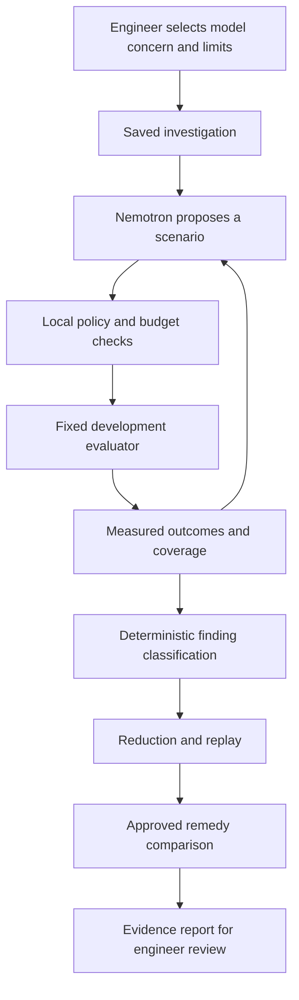

# Sidekick implementation roadmap for Nebius and NVIDIA

This roadmap is ordered by dependencies and completion criteria. It has no calendar estimates. The status table below records what is now implemented. Runtime, experiment and spending limits remain necessary product controls.

## Product direction

Build an investigation workbench for engineers deciding whether an equipment-warning model can tolerate unreliable sensors. An engineer chooses a fitted model, describes a concern and sets bounds. Nemotron proposes experiments, Sidekick executes controlled sensor corruptions, and the engineer receives reproducible failures, simplified scenarios and measured remedy tradeoffs.

The central demonstration should be: discover a compound scenario that degrades useful warnings, reproduce it, simplify it, test a remedy, and show both the benefit and its cost elsewhere.

The recommended hackathon track is Best Apps and Agents. Coding and Agentic Engineering would require making code generation and testing central to the product. A predictive-maintenance domain alone does not make this an embodied Physical AI project.

## Status on 30 October 2026

Phases 0 to 11 and the packaging work in phase 13 are implemented on `feat/submission-final`, with offline tests, browser tests and recorded live evidence. Phase 12 needs a human reviewer.

| Phase | State | Evidence |
| --- | --- | --- |
| 0. Live baseline | Done | Bounded live runs on Windows; captures kept privately; root MIT license |
| 1. Finding criteria | Done | `findings.py`; deterministic classification with coverage gates |
| 2. Domain constraints | Done | `synthetic-rotating-v1` profile with provenance; dataset-aware timing |
| 3. Adaptive selection | Done | Hypotheses cite earlier results; rejected replies return feedback; live runs show refinement of a measured failure |
| 4. Reduction | Done | Component removal and grid search with saved lineage and regression export |
| 5. Remedies | Done | Threshold and approved augmented remedies; benefits, unresolved failures, exclusions and cost reported together |
| 6. Search benchmark | Done | `evidence/benchmarks/`; recorded Nemotron runs compared on their own context and allowance |
| 6. Independent validation | Done | Frozen procedure, one assessment on fresh histories, exposure ledger |
| 7. HTTP API | Done | Idempotent starts; repeated or enlarged agent starts cannot exceed the saved allowance |
| 8. Browser workflow | Done | Real-backend browser test from create to export; distinct states for every outcome |
| 9. Remote execution | Done | Pinned Linux runtime for contexts, coordinator and workers; worker image replay check |
| 10. Portable evidence and public demo | Done in code | Public exports and recorded evidence shown read-only on the hosted site; the site updates when this branch reaches `main` |
| 11. Failure-mode verification | Done | Offline suite, captured live replies, browser suite, worker and hosted-memory checks |
| 12. Engineer validation | Needs a reviewer | `docs/sidekick-engineer-evaluation.md` and the evaluation pack |
| 13. Submission | Owner steps remain | Push, deploy, video, Nebius/NVIDIA feedback; see `docs/nebius-submission.md` |

Known limits: findings come from synthetic development data; the 0.95 demonstration threshold is deliberately fragile; Windows and Linux model fits differ in the last bits, so strict replay is per platform; no field or financial benefit is claimed.

## Implementation principles

- Nemotron proposes hypotheses and experiments. Deterministic code calculates measurements and qualification.
- Keep models, preprocessing, thresholds, fault policy and data identity fixed during a search.
- Treat missing coverage as missing evidence, not successful robustness or a discovered model failure.
- A model's explanation is a hypothesis. A reproducible corruption is not proof of an equipment failure mechanism.
- Keep raw histories and private replay packages local unless their transfer is explicitly authorized.
- Reuse existing modules and UI conventions. New code should follow the requested compact, pragmatic style; preserve existing public field names and interfaces.
- Add abstractions only when a second concrete execution path needs them. Start with one controller and one local worker.
- Save progress and evidence. Refreshing a page or restarting a process must not reset usage or silently initiate paid work.

## 0. Establish a live, reproducible baseline

Build:

1. Use the Desktop checkout as the canonical development copy and record the selected commit in run metadata.
2. Confirm the local key without printing it. Verify the exact configured Nemotron model against the active Token Factory endpoint.
3. Run the existing small synthetic investigation with explicit provider permission, at most two calls and the agreed cumulative completion allowance. Keep this separate from real equipment data.
4. Inspect structured replies, validation failures, accepted proposals, experiment results, model stops, persisted counters and restart behavior.
5. Preserve a sanitized capture with model ID, prompt version, settings, request identifiers, elapsed time and actual usage if returned. A failed live call is useful evidence, but is not a completed end-to-end test.
6. Add the root license after checking ownership and existing dependency notices. Keep recorded ABB evidence attributable while describing the new adaptation clearly.
7. Correct outdated documentation that still describes the adaptive controller as future work.

Primary existing seams: `scripts/check_nebius.py`, `scripts/run_fault_investigation.py`, `backend/app/investigator/controller.py`, provider adapter and setup guides.

Complete when a real Nemotron proposal is validated, evaluated and saved, and a subsequent status read proves the durable state. Invalid responses must stop or consume their documented allowance without inventing evidence.

## 1. Define what counts as a useful discovery

Build a typed, server-owned investigation objective instead of relying on free text to define success. Keep free text as optional context.

Specify the target model, useful-warning requirements, maximum acceptable alarm burden, minimum eligible-history coverage, and a minimum consequential change. Support clear outcomes such as newly missed warnings, warnings shifted outside the useful window, and increased early alarm burden.

Use clean and faulted outcomes from the same eligible histories. Require adequate clean behavior before calling a change a newly induced failure. Record absolute faulted performance as well as the change from clean. An already poor clean model must not generate misleading discoveries.

Save the criterion version and its parameters with the investigation. Distinguish an execution error, an invalid proposal, a scenario with no changed scorable readings, an inconclusive result and a measured failure. Store evidence IDs and per-history support for every discovery.

Suggested new seam: `backend/app/investigator/findings.py`, reusing `FaultEvaluation` and existing metric definitions.

Complete when the same saved evaluation always produces the same finding classification without any provider call, and coverage or execution failures cannot be counted as discoveries.

## 2. Add defensible domain constraints

Extend `FaultPolicy` through versioned profiles for one named equipment/sensor setup at a time. Start with synthetic profiles and clearly label their assumptions.

Profiles should define permitted sensor combinations, measurement-corruption mechanisms, severity and timing bounds, and applicable units. Where supported by evidence, represent shared acquisition/power failures, delays between channels and whether faults may overlap. Keep physical process changes separate from measurement corruption.

Attach provenance to each constraint: declared prototype assumption, documented sensor behavior or engineer-reviewed rule. Correlation can suggest a combination worth testing; it does not establish a shared cause. Do not assign physical bearing semantics to anonymous NASA channels without supporting documentation.

The current injection system supports independent faults on different sensors, not same-sensor overlap or a coupled physical simulator. Add new semantics only with explicit contracts and evaluator tests. Retain the existing behavior for old scenarios.

Give Nemotron reviewed, bounded descriptions through the existing channel aliases. Validate them as untrusted context and exclude private contacts and raw readings.

Complete when invalid combinations are rejected before scoring, accepted cases explain the profile assumptions they rely on, and all search baselines can use exactly the same constraints.

## 3. Improve adaptive experiment selection

Extend the existing controller rather than building another agent framework.

Add a bounded hypothesis record: what behavior is suspected, the proposed scenario, what measurement would support it and what result would weaken it. Link subsequent decisions to real result IDs. Preserve the separation between model-authored reasons and server-computed observations.

Begin from clean performance and a small measured seed suite. Balance exploration of untested combinations with refinement of promising failures. Summarize tested families, rejected cases, best findings, unresolved questions and budget use without an ever-growing transcript.

Keep exact canonical duplicate detection. Add family-level novelty reporting so a series of nearly identical severities is not presented as many independent breakthroughs. Record model-requested stops separately from budget stops and never interpret a stop as proof of robustness.

Use the configured Super model first. Compare other available Nemotron models only after a stable workload exists. Use a smaller model for a measured language task if it helps; do not use it to classify outcomes already determined by code.

Complete when captured runs show that a later proposal responds to a prior result, stays within the policy and does not repeatedly spend experiments on the same case.

## 4. Reduce failures to simpler reproducible scenarios

Implement a deterministic reducer around the finding predicate. Nemotron may suggest an ordering, but every accepted reduction must be rerun and checked locally.

First attempt to remove each component. Then search explicit grids for lower drift severity, shorter duration and simpler timing, where those comparisons are meaningful. Do not assume the failure predicate is monotonic in severity or timing.

Each reduction gets its own bounded experiment allowance. Preserve the same model, thresholds, criterion and relevant history cohort, or disclose cohort changes and reject unsupported comparisons. Require sufficient coverage throughout.

Save the original case, attempted changes, accepted steps, results and the final case. Describe the result precisely: component-minimal under tested removals, or minimal on a specified grid. Do not claim a global minimum without proving it.

Export the simplified scenario as a regression case. Count its discovery family once in comparative search metrics; reduction reruns are additional work, not new failures found.

Suggested new seam: `backend/app/investigator/reduction.py`, using the existing runner, evaluator and store.

Complete when a compound failure can be simplified through recorded reruns, and removing any remaining component no longer preserves the criterion under the declared test.

## 5. Test remedies and their costs

Add a small catalog of remedies that the existing pipeline can actually execute: an existing augmented candidate, an explicit missing-data/preprocessing variant, a sensor-quality fallback or a separately selected warning rule.

Keep training outside the investigation loop. A remedy requiring training creates a new fitted context with its own fingerprint and development-only training. A threshold change is an explicit candidate change, not a hidden adjustment to the original experiment.

Evaluate the original and remedy on the discovered case, the reduced case, clean histories and an unchanged regression suite. Use matched histories, show exclusions and report detection, useful lead and alarm burden together. Measure runtime or resource cost where relevant to the remedy.

Require explicit approval for a training job. A recommended remedy must not silently replace a deployed model. A remedy that fixes one discovered case may overfit it; keep fresh validation separate from the data used to choose the remedy.

Suggested new seam: `backend/app/investigator/remedies.py`, integrated with existing model training, augmentation, paired comparisons and qualification.

Complete when Sidekick can say what changed, which failure improved, what degraded elsewhere and whether the candidate still meets the declared acceptance criteria.

## 6. Measure whether adaptive search helps

Build a strategy-neutral benchmark harness. Compare the fixed suite, constrained random search, a conventional optimizer suitable for the mixed discrete/continuous space, and the Nemotron controller.

CMA-ES is not automatically suitable for sensor identities and fault kinds. If included, document the encoding, repair rules and feasible-space behavior. A discrete search with a simple numerical optimizer may be a more useful first comparator.

Give every strategy the same frozen models, constraints, initial evidence and discovery predicate. Report both equal experiment-count comparisons and total resource cost. Count malformed/rejected proposals, duplicates, failed executions and reduction work rather than hiding them.

Measure consequential unique failure families, experiments to first finding, strongest measured degradation, useful coverage, feasible proposal rate, diversity, elapsed time and actual provider usage. Record the deduplication rule before comparing strategies.

Use multiple seeds and contexts. Keep search development separate from validation used to assess discovered cases. Where intervals are reported, respect equipment-history grouping rather than treating overlapping windows as independent observations. Adaptively selected out-of-fold findings remain exploratory.

Reuse the exposure ledger. Historical FD001 evidence already inspected by the team is not a new sealed holdout. Lock the final search/remedy protocol before a one-time reserved assessment. Revising the approach after inspecting that assessment requires fresh evaluation data for another independent claim.

Complete when a reproducible report states where the controller helps, where it does not, and its added cost. If random search wins, report that result and improve the selection strategy rather than claiming superiority.

## 7. Expose the investigation through a durable API

Connect the CLI engine to FastAPI through a background worker. Do not run the entire controller in a request handler or create a second execution store.

Provide operations to create an investigation, explicitly start it, read status/events/results, request cancellation, resume eligible work, replay a result, request reduction, start an approved remedy comparison and export evidence. Endpoint names should follow the existing API conventions.

Resolve fitted contexts from owned application experiments through a trusted registry. Never accept a browser-uploaded joblib file as a context. Record workspace ownership, consent scope and context identity on admission.

Use idempotent start requests and the existing lease/fencing checks. Persist events before presenting them. A worker restart must recover work within saved allowances. Permission revocation must block new cloud requests and prevent late replies from publishing after cancellation.

Reuse polling first; add event streaming only if it improves the existing experience. Generate frontend types from the backend contract. Keep the existing read-only Deep investigation behavior intact and clearly distinguish it from experiment execution.

Suggested new route: `backend/app/api/routes_investigations.py`; extend existing worker infrastructure only where needed.

Complete when the full lifecycle works through HTTP, cross-workspace reads and starts are rejected, and refreshing or retrying a request does not cause duplicate paid work.

## 8. Build the browser investigation workflow

Add a coherent flow to the existing React app:

1. Choose a fitted development model and review clean performance.
2. Choose the concern, equipment profile, bounds and experiment/provider allowances.
3. Preview the information sent to Nebius and explicitly start.
4. Follow proposals, validation, experiments, findings and usage in an event timeline.
5. Inspect matched clean/faulted warning traces and the affected-history count.
6. Reduce a finding, compare a remedy and export the evidence.

Show concrete empty, running, rejected, partially covered, cancelled, interrupted, budget-exhausted, provider-error and completed states. Separate cancellation from resumption; reopening a saved run is read-only.

Make clear which text is a hypothesis and which numbers are measured. Display the tested assumptions, thresholds and exclusions close to each conclusion. Keep existing single-sensor protocols recognizable rather than silently changing their interpretation.

Distinguish reserved token ceilings from actual reported usage. Dollar estimates, if shown, need a dated price source and must not be presented as a guaranteed spending cap.

Complete when a reviewer can discover, inspect, simplify and compare a failure without terminal access, and keyboard use, refresh, errors and cancellation work predictably.

## 9. Add Nebius execution where it is useful

Token Factory already supplies the required NVIDIA-model execution path. Serverless Jobs and Endpoints are optional platform choices, not automatic extra judging points.

Keep the adaptive sequence dependent on observed results. Parallelize independent baseline trials, seeded scenarios, regression cases, reduction candidates where valid, and remedy evaluations.

Create a containerized finite worker accepting a validated job manifest and returning a bounded result artifact. Use immutable context/version references, checksums, job IDs, bounded retries, resource/concurrency limits and fenced result acceptance. Treat transport as potentially delivering work more than once; deduplicate publication without claiming the remote computation ran exactly once.

Keep SQLite with one coordinator. Remote workers should return results through an API or artifact store; do not share a SQLite file over object/network storage. Durable result records must survive ephemeral containers.

Private context packages contain raw data. Offer local execution by default and transfer packages only under explicit cloud-processing consent. Separate server secrets, object access and public evidence.

Use Serverless Endpoints only for an actual persistent inference need. Current small tabular estimators do not become better by being placed on an idle GPU. Measure the workload before adding GPU execution, another database or a distributed scheduler.

Complete when a failed or duplicated remote job cannot overwrite a valid result, a late completion cannot bypass cancellation, and the same case agrees with local execution within declared tolerances.

## 10. Make evidence portable and the public demo dependable

Create a public investigation export distinct from trusted private replay packages. Include approved scenario parameters, profile assumptions, aggregate findings, coverage, model/context/prompt identifiers, reduction history, remedy comparisons, benchmark method and reproduction instructions.

Exclude secrets, private objectives, raw real-data histories and equipment identifiers. Hashes establish integrity, not authenticity or permission to disclose data. Public replay must use distributable synthetic data or appropriately licensed inputs; it must not require loading an untrusted uploaded executable artifact.

Deploy a working application with persistent investigation state, capacity controls, logs and health checks. Keep public live work behind bounded admission and server-side quotas; do not publish an unrestricted API-key proxy. Provide an accurate, clearly labeled recorded investigation for review when live inference is unavailable.

Measure provider errors, structured-response failures, request latency, actual usage and worker failures. Enforce actual process termination/resource limits where cooperative cancellation cannot interrupt a native scoring call.

Complete when a fresh reviewer can run or inspect the project, export a self-contained report and understand which operations were live, which were recorded and what data each result used.

## 11. Verify the product through its real failure modes

Verification belongs in every phase. Keep ordinary CI offline and use captured/mock responses for provider failures. Run paid smoke checks only through an explicit bounded command.

Extend focused tests for finding criteria, constraint versions, reduction claims, remedy comparisons and search accounting. Exercise malformed responses, unknown aliases, unsupported combinations, near-duplicates, low coverage, provider truncation/timeouts, cancellation, budget exhaustion, lease loss, stale results and process crashes.

Add API ownership/consent/idempotency checks and browser coverage for the complete investigation flow. Keep generated types current and retain the existing lint, backend, browser and hosted-resource checks. Fresh-checkout reproduction and exported-result verification are release checks, not substitutes for unit tests.

Complete when the important lifecycle and evidence boundaries survive failure injection without changing original results, leaking data or resetting paid-work limits.

## 12. Validate usefulness with an engineer

Use the existing pilot workflow to choose one equipment family, one model-selection decision and one reviewer. Ask whether the discovered scenario is relevant, whether its assumptions are defensible, and whether the evidence changes the reviewer's proposed next action.

Compare the existing fixed-suite review with the adaptive investigation. Measure completion time, relevant findings, incorrect interpretations, clarity of the next action and the amount of manual verification required. Distinguish observed task measurements from self-reported impressions.

MotionLogger can later provide a sensor acquisition testbed, but motion classification is not automatically a predictive-maintenance benchmark. A suitable task, labels, provenance and baseline must be defined before using it as maintenance evidence. An unrelated USV integration is a separate product expansion.

Complete when an actual reviewer can explain the result, identify its limitations and name a supported next action. Synthetic evidence alone does not establish equipment or financial impact.

## 13. Package the hackathon submission

Choose Best Apps and Agents unless the implemented product changes substantially. Prepare:

- A public repository with the project's open-source license and preserved dependency notices.
- Fresh setup/run instructions, environment example and a one-command synthetic investigation.
- A working demo URL and a public YouTube video no longer than three minutes.
- A concrete description of the audience, decision, architecture, actual NVIDIA model ID and Nebius services used.
- A comparison between the earlier Sidekick project and the significant work completed within the submission period, supported by real commits and artifacts.
- Measured results with denominators, coverage, benchmark conditions and limits.
- Feedback based on actual Nebius/NVIDIA usage, including structured output, reasoning controls, latency, errors and deployment experience.

The strongest video follows one case from clean warning through discovered corruption, reduction, remedy and evidence export. Use recorded results honestly when inference cannot complete during the video. Keep comparisons and quantities tied to stored artifacts rather than model narration.

Submission requirements still apply even though this engineering roadmap has no deadlines. Do not label later work as having been completed during an earlier eligible period.

Complete when an unfamiliar reviewer can access the demo, reproduce the documented example and verify the claims without private assistance.

## Recommended implementation sequence

First deliver a real CLI investigation and deterministic finding classification. Then add domain profiles, adaptive selection improvements and reduction. Build remedy comparisons and the fair benchmark harness before making claims about the approach's advantage. Connect the stable engine to the API and browser, add remote execution when measured workloads justify it, and finish evidence exports, reviewer validation and submission packaging.

The first five concrete changes should be:

1. Finish the Desktop live smoke run and save a sanitized capture.
2. Implement typed finding criteria with coverage checks.
3. Add a deterministic component-removal reducer and its saved lineage.
4. Compare controller search against constrained random and a fixed suite on the same fixture.
5. Expose create/start/status/cancel/results through the existing worker and workspace permission model.

Domain profile work should accompany these slices. Do not call a profile physically validated before the relevant review or measurements exist. Numerical reduction, additional models and remote concurrency can follow the first end-to-end slice.

## Scope boundaries

Do not make fine-tuning, a vector database, many cooperating agents, arbitrary generated-code execution, a new UI framework, live robot control or a fleet-wide digital twin prerequisites. Each needs its own demonstrated problem and evidence. A larger model is not a substitute for a better experiment or fair evaluation.

The project is ready as a strong technical submission when it discovers an admissible measured failure, reproduces and simplifies it, evaluates a remedy with visible tradeoffs, demonstrates useful adaptive behavior, and presents the complete workflow through a usable application with reproducible evidence.

## References

- [Official hackathon requirements and judging criteria](https://nebiusglobalaihackathon.devpost.com/).
- [Official rules, including existing-project updates and submission artifacts](https://nebiusglobalaihackathon.devpost.com/rules).
- [Nebius Nemotron model guides](https://github.com/nebius/token-factory-cookbook/tree/main/models/nemotron); verify exact availability for the account and endpoint.
- [Nebius Serverless Jobs and Endpoints overview](https://nebius.com/serverless).
- Existing implementation guides: `docs/nebius-phase-1.md`, `docs/nebius-phase-2.md`, `docs/nebius-phase-3.md`.
